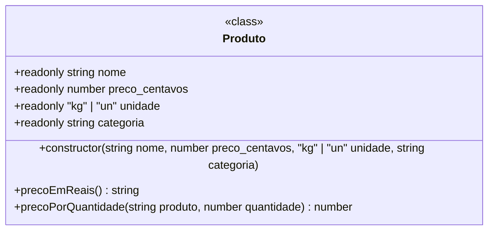
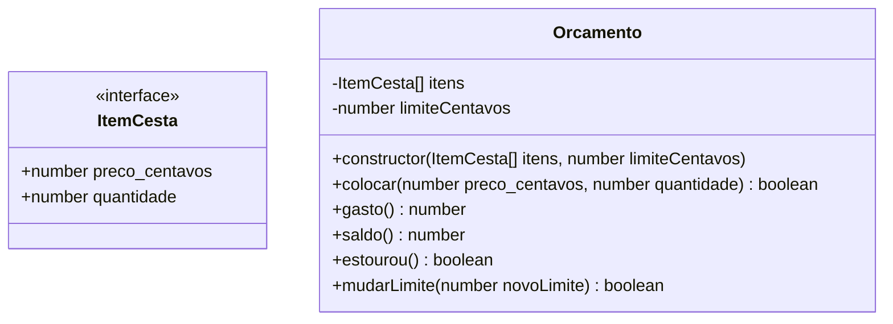

# Modelo do produto

O mapa das classes do backend. Cada dono acrescenta a sua peça no PR em que ela vira classe. O GitHub desenha o diagrama sozinho.




```mermaid
classDiagram
  class Catalogo {
    -Produto[] produtos
    +string[] recusados
    +constructor(caminho: string)
    +buscar(nome: string) : Produto | undefined
    +precoDe(nome: string) : number | undefined
    +quantidade() : number
  }
  ```


